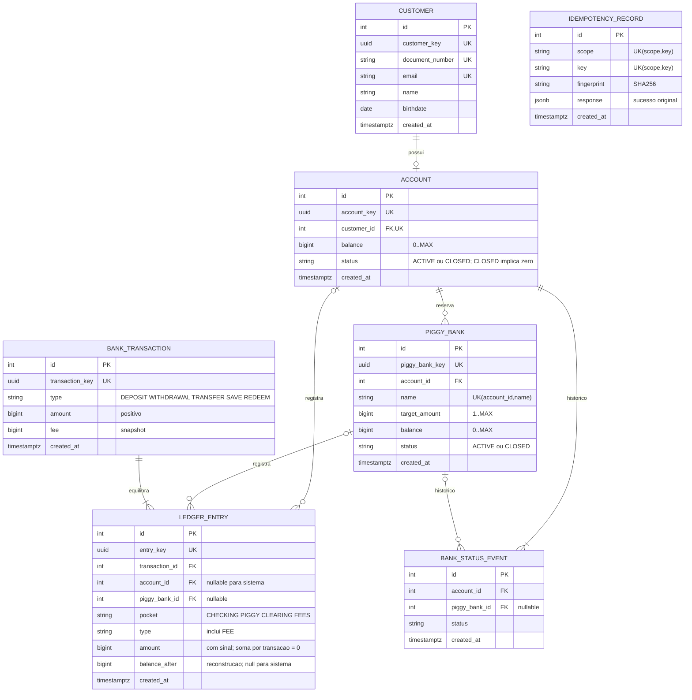

# RFC - Proposta de banco com reservas em porquinhos

**TIME:** Vinicius e Wallace  
**DATA:** 12/10/2026  
**VERSÃO:** 1.0

## Contextualização

### Entendendo o problema

O banco permite cadastrar clientes adultos, abrir uma conta por cliente, depositar,
sacar, transferir com tarifa e consultar o extrato paginado. Porquinhos separam dinheiro
para metas pessoais e permitem resgate imediato. Sistemas internos autorizados usam
essas operações. O dinheiro não pode ser gasto duas vezes, ficar negativo ou desaparecer
entre conta e reserva. Repetir um pedido não pode duplicar a movimentação. O extrato
precisa reconstruir o saldo, incluindo a tarifa. Uma falha nessas garantias produz
saldo divergente e cobrança indevida. Fora do escopo: dinheiro real, Pix, boletos,
rendimento, crédito, estorno, exclusão de histórico e autenticação de correntistas.

### Explicando a solução de forma macro

Uma API interna e um banco persistente atendem todas as operações; o monitoramento é
opcional. Cada movimento grava um diário com contrapartidas e atualiza o saldo na mesma
transação. Reservar apenas muda o bolso do dinheiro. Valores são inteiros em centavos
de BRL. Travas ordenadas protegem o saldo, a chave do pedido protege retentativas e
restrições do banco comprovam a reconciliação. Cliente tem CPF válido e único, e-mail
normalizado e único, e idade entre 18 e 120 anos. Transferência cobra R$ 1,00 da origem,
além do principal; depósito, saque, reserva e resgate não cobram tarifa. A meta é
informativa, aceita valor acima do alvo e não bloqueia resgate.

- Float descartado: arredondamento distorceria dinheiro; seria adequado a medidas aproximadas.
- Saldo só calculado por extrato descartado: encarece leitura e não elimina a trava; ganharia em um diário pequeno sem leituras frequentes.
- Saldo sem diário descartado: não permitiria reconstrução nem provar a tarifa; ganharia somente em um contador não financeiro.
- Serviços e fila separados descartados: exigiriam coordenação distribuída e compensações; ganhariam com equipes e volumes independentes.

## Implementação

### Rotas

Todas as rotas de negócio e métricas exigem INTERNAL-TOKEN; ausência ou erro retorna
403 QIT000002 antes de acessar o banco. JSON inválido, campo desconhecido, tipo, valor
ou paginação inválidos retornam 400 QIT000001. Todo POST exige Idempotency-Key ASCII
de 1 a 128 caracteres: UNIQUE(scope,key) e hash do JSON canônico. Sucesso repetido
retorna o mesmo 201 e corpo; outro corpo na mesma chave retorna 409 QIT002006.
Falha não grava a chave. GET é leitura; PATCH de encerramento é idempotente por estado
e não duplica eventos. Paginação: limit 1..100, padrão 10; page >= 0, padrão 0,
ordenada por id decrescente; saída data, limit, page, is_last_page. UUIDs são públicos;
ids inteiros são internos. Dinheiro de entrada: inteiro 1..9.000.000.000.000.000 centavos.

A = `/accounts/{account_key}`; P = `A/piggy_banks/{piggy_bank_key}`.

| Método | Caminho | O que faz / entrada | Saída e erros específicos |
|---|---|---|---|
| GET | / | Identifica serviço; público | 200 service, id do processo |
| GET | /health_check | Prova de vida; público, sem banco | 204 |
| GET | /metrics | Métricas; token obrigatório | 200 texto Prometheus |
| POST | /customers | name, email, document_number, birthdate | 201 customer_key; 409 cadastro único; 422 CPF/data/idade |
| GET | /customers/{customer_key} | Busca cliente | 200 dados; 404 cliente |
| GET | /customers | limit, page | 200 página |
| POST | /accounts | customer_key | 201 account_key; 404 cliente; 409 conta já existe |
| GET | /accounts | limit, page | 200 página |
| GET | A | Saldo disponível, reservado, total, eventos | 200 conta; 404 conta |
| PATCH | A | status=CLOSED | 200 conta; 404 conta; 409 saldo disponível ou reservado |
| POST | A/transactions | type=DEPOSIT/WITHDRAWAL/TRANSFER, amount; destination_account_key só no TRANSFER | 201 transação com fee; 404 conta; 409 encerrada/mesma origem; 422 saldo inclui tarifa/limite |
| GET | A/transactions | limit, page | 200 extrato disponível; 404 conta |
| POST | A/piggy_banks | name, target_amount | 201 piggy_bank_key; 404 conta; 409 encerrada/nome repetido |
| GET | A/piggy_banks | limit, page | 200 página; 404 conta |
| GET | P | Consulta reserva e eventos | 200 porquinho; 404 conta/porquinho ou vínculo incorreto |
| PATCH | P | status=CLOSED | 200 porquinho; 404 conta/porquinho; 409 reserva não vazia |
| POST | P/transactions | type=SAVE/REDEEM, amount | 201 transação sem tarifa; 404 conta/porquinho; 409 encerrado; 422 saldo/limite |
| GET | P/transactions | limit, page | 200 extrato da reserva; 404 conta/porquinho |

Erros: 404 QIT002001; 409 duplicidade QIT002002, estado QIT002005 ou chave QIT002006;
422 cliente QIT002003, saldo QIT002004 ou limite QIT002007; 503 QIT002008 em falha/prazo
do banco. Erros usam title, description, translation e code. As rotas sample_entity
herdadas continuam como exemplo da base, documentadas separadamente.

### Banco de Dados (Somente diagrama)

### Fluxos

**Cadastrar cliente e abrir conta - caminho feliz**

1. Valida corpo e chave; tenta inserir o registro de idempotência.
2. Valida CPF, data e idade; normaliza e-mail; grava cliente.
3. Confirma cliente e resposta juntos; retorna UUID. Abrir conta é outro pedido.
4. Busca cliente, grava conta zerada e evento ACTIVE; confirma com a resposta.

**Falha: cadastro simultâneo duplicado**

1. Dois pedidos com chaves distintas tentam cadastrar o mesmo CPF/e-mail ou conta.
2. UNIQUE aceita um e recusa o outro. O perdedor desfaz tudo, incluindo sua chave,
   e recebe 409. Chave igual com corpo igual espera e recebe o sucesso original.

**Depositar ou sacar - caminho feliz**

1. Reclama a chave e trava a conta com SELECT FOR UPDATE; confere ACTIVE.
2. Depósito aumenta o disponível e debita CLEARING. Saque reduz o disponível
   e credita CLEARING. Cada lançamento preserva o saldo após sua aplicação.
3. Os gatilhos conferem soma zero, diário imutável e reconciliação.
4. Confirma saldo, transação, lançamentos e resposta juntos; devolve 201.

**Falha: dois saques disputam saldo**

1. Com 1.000 centavos, dois saques de 700 pedem a mesma trava.
2. O primeiro confirma e deixa 300. O segundo lê 300 após obter a trava.
3. O segundo recebe 422; não deixa débito, lançamento, transação nem chave.
   Depósito acima do limite de saldo também desfaz o pedido inteiro.

**Transferir com tarifa - caminho feliz**

1. Reclama a chave; trava origem e destino em ordem crescente dos ids internos.
2. Confere ambas ativas, diferentes e saldo cobrindo principal + 100 centavos.
3. Debita principal da origem, registra; debita tarifa, registra FEE; credita
   principal no destino e tarifa em FEES. A soma dos quatro lançamentos é zero.
4. Confirma todas as alterações junto à resposta. O extrato exibe a tarifa separada.

**Falha: destino encerrado, limite ou saldo sem tarifa**

1. Destino ausente retorna 404; encerrado ou igual à origem retorna 409.
2. Principal caber sem a tarifa, ou destino ultrapassar limite, retorna 422.
3. Toda a transação é revertida. Não há débito parcial nem tarifa isolada.
   Transferências cruzadas usam a mesma ordem de travas e evitam inversão.

**Guardar e resgatar - caminho feliz**

1. Cria porquinho numa conta ativa, com nome único, meta e evento ACTIVE.
2. No movimento, reclama a chave; trava primeiro a conta e depois seu porquinho.
3. SAVE debita disponível e credita reserva; REDEEM faz o inverso, sem tarifa.
4. Grava duas contrapartidas e confirma com a resposta. Total não muda;
   alcançar a meta não impede novos aportes nem resgates.

**Falha: reserva indisponível ou disputa com saque**

1. Porquinho de outra conta retorna 404; conta ou porquinho encerrados, 409.
2. Aporte sem disponível ou resgate sem reserva retorna 422 sem movimento.
3. Aporte e saque disputam a trava da mesma conta: o segundo usa o saldo novo,
   e não pode gastar dinheiro já reservado pelo primeiro.

**Encerrar - caminho feliz e falha**

1. Trava a conta; para encerrar porquinho, trava também a reserva.
2. Reserva só encerra vazia; conta só encerra com disponível e reservas zerados.
3. Grava CLOSED e evento na mesma transação. Repetir retorna o estado sem novo evento.
4. Se há dinheiro, retorna 409 e mantém estado e histórico. Leituras continuam permitidas.

**Consultar extrato - caminho feliz e falha**

1. Valida paginação e vínculo; busca limit+1 lançamentos ordenados por id decrescente.
2. Devolve até limit linhas, saldo após cada linha e indicador de próxima página.
3. Conta ou reserva inexistente retorna 404; query inválida, desconhecida ou repetida, 400.
4. Páginas são leituras independentes: novos movimentos podem deslocar offsets entre
   consultas. Para leitura estável em alto volume, evoluir para cursor/snapshot.

**Retentativa e falha operacional**

1. Chave já confirmada retorna a resposta gravada antes de consultar estado atual.
2. Se a trava demora mais de 5s, comando mais de 10s ou conexão falha, retorna 503.
3. A sessão fecha e desfaz o trabalho pendente; o cliente repete com a mesma chave.
4. Se o commit ocorreu mas a rede perdeu a resposta, a repetição recupera o sucesso;
   não credita nem cobra duas vezes. X-Request-ID permite localizar logs sem dados pessoais.

**Principal desafio**

Qual é: impedir gasto duplicado entre conta, transferência com tarifa e porquinho,
inclusive em pedidos concorrentes, retentativas e falha no meio da gravação.
Por que é difícil: ler saldo e depois gravar deixa uma janela; guardar e sacar podem
gastar o mesmo disponível; tarifa separada pode confirmar sem principal; a rede pode
perder uma resposta após commit.
Como o desenho resolve: trava contas em ordem de id, trava porquinho só depois da conta,
mantém saldo e diário em uma transação e persiste a resposta sob UNIQUE(scope,key).
Gatilhos diferidos verificam contrapartidas, saldo e histórico no commit. Recalcular
o diário custa mais com histórico grande; aceitamos esse custo para demonstrar
integridade. Há métricas, alarmes configurados e timeout de banco; não há serviço
externo, worker, cloud auto scaling nem notificação externa instalados nesta entrega.
